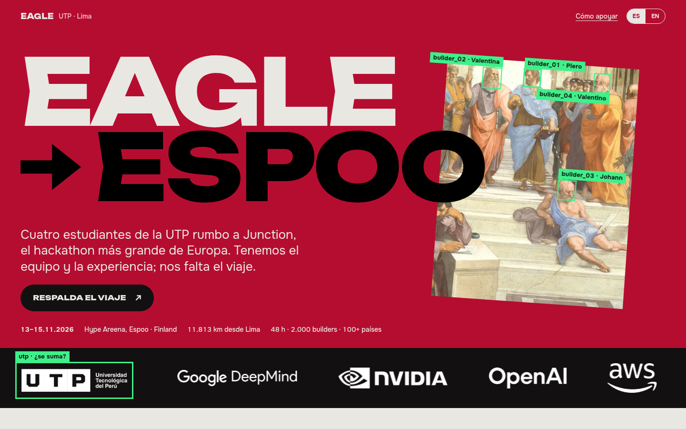
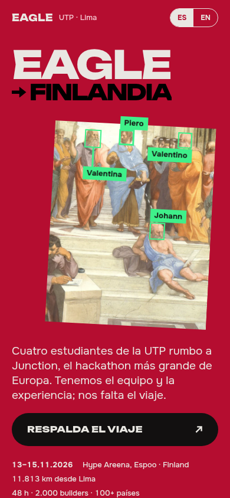

<div align="center">

# EAGLE → ESPOO

**Cuatro estudiantes de la UTP rumbo a Junction 2026, el hackathon más grande de Europa.**<br>
<sub>Four UTP students heading to Junction 2026, Europe's biggest hackathon · 13–15.11.2026 · Hype Areena, Espoo, Finland</sub>

<br>



<br>

**[Ver la web →](https://eagle-junction-2026.vercel.app)**<br><br>

[Junction 2026](https://2026.hackjunction.com/) · [Equipo](#el-equipo) · [Correr en local](#correr-en-local) · [Deploy](#deploy)

</div>

---

## La idea

Junction 2026 mezcla pinturas del Renacimiento con cultura hacker. Esta web toma ese lenguaje y lo pone al servicio de un pedido concreto: **que la UTP respalde el viaje Lima → Espoo**.

Fragmentos de Rafael, Miguel Ángel y Botticelli pasan por un "detector" de visión por computadora que encuentra a los cuatro integrantes del equipo. Todo va sobre el carmesí de la UTP, con tipografía de póster y los partners del evento en la primera pantalla.

| | |
| :-- | :-- |
| **Para quién** | La Universidad Tecnológica del Perú y posibles patrocinadores |
| **Qué pide** | Apoyo para viajar a Junction 2026 (Espoo, Finlandia) |
| **Qué ofrece** | El nombre UTP en el escenario, cobertura para sus canales y un taller abierto al volver |
| **Idiomas** | Español / English, con un selector en la cabecera |

## El equipo

| | Rol | |
| :-- | :-- | :-- |
| **Piero Pérez** | Backend · Multi-agent AI | [LinkedIn](https://www.linkedin.com/in/piero-perez-izquierdo/) · [GitHub](https://github.com/piales00) |
| **Valentina Ayerve** | Agile · Data · IA | [LinkedIn](https://www.linkedin.com/in/valentina-ayerve-devcode) |
| **Johann Diaz** | Data · Business Intelligence | [LinkedIn](https://www.linkedin.com/in/johann-diaz-96137a2a9) |
| **Valentino Llamocca** | Product · Estrategia | [LinkedIn](https://www.linkedin.com/in/valentino-llamocca-barraza-9a279a315) |

Tres becas de excelencia académica UTP, los cuatro en LEAD UTP y un **Top 2 en Stellar Odyssey Perú 2026** con [Masi](https://masiapp.vercel.app).

<div align="center">

</div>

## Qué hay dentro

```
.
├── index.html        # toda la página: HTML, CSS y JS sin dependencias
├── favicon.svg
├── img/              # pinturas, retratos, logos de partners y empresas
├── docs/             # capturas para este README
└── vercel.json       # URLs limpias y caché larga para /img
```

- **Sin build ni frameworks.** Es un único `index.html`. Las fuentes vienen de Google Fonts (Unbounded y Onest).
- **Movimiento con intención.** El titular entra en una sola secuencia y las cajas de detección se "enganchan" a las caras. La banda de partners está en movimiento. Todo respeta `prefers-reduced-motion`.
- **Pensada para el celular.** Como en pantallas táctiles no existe el *hover*, las fotos y los logos se colorean al cruzar el centro de la pantalla.

## Correr en local

```bash
git clone https://github.com/piales00/eagle-junction-2026.git
cd eagle-junction-2026
python3 -m http.server 8000   # luego abre http://localhost:8000
```

## Deploy

Es un sitio estático, así que Vercel lo sirve tal cual:

```bash
npx vercel --prod
```

También puedes importar el repo en [vercel.com/new](https://vercel.com/new) sin configurar nada: no tiene comando de build y el directorio de salida es la raíz.

## Créditos

- **Obras de dominio público** (Wikimedia Commons): Rafael, *La Escuela de Atenas*; Miguel Ángel, *La creación de Adán*; Botticelli, *El nacimiento de Venus*.
- **Inspiración visual:** [2026.hackjunction.com](https://2026.hackjunction.com/).
- **Logos:** los de los partners vienen de la web de Junction 2026 y son de sus dueños. Patrocinan el evento, no a este equipo. El logo y la trama del Programa Impulsa vienen del sitio de la Dirección de Empleabilidad UTP. Los logos de la UTP, BCP, Interseguro, Tecsur y Diesel Autopartes del Perú se usan solo como referencia.

<div align="center">
<br>
<sub>Hecho en Lima, rumbo a Espoo · 11.813 km</sub>
</div>
